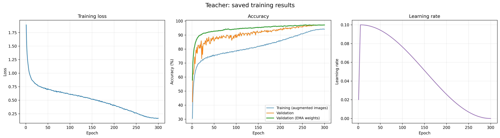
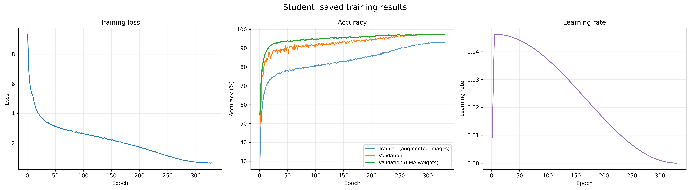
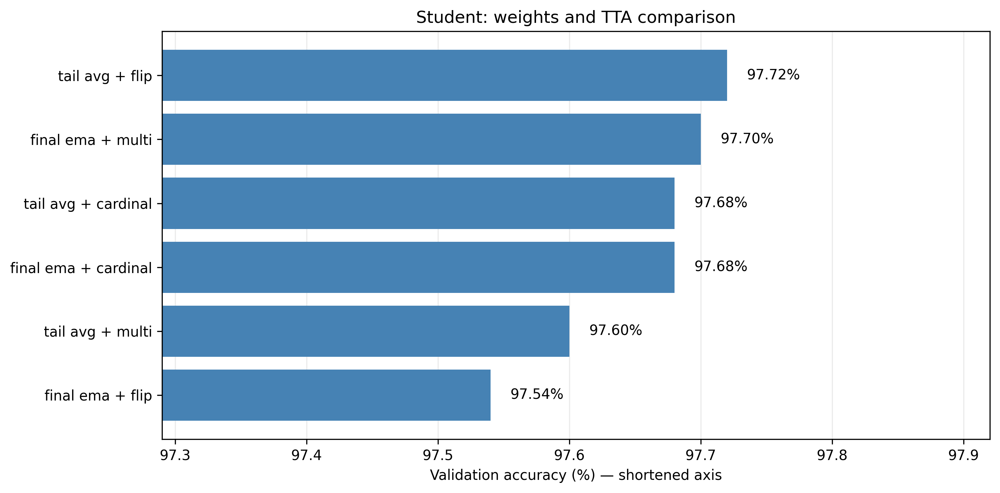
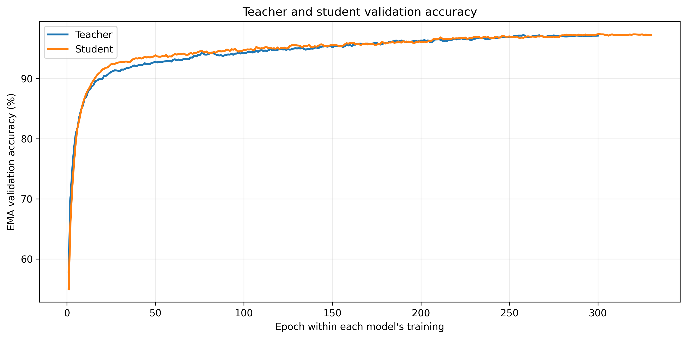
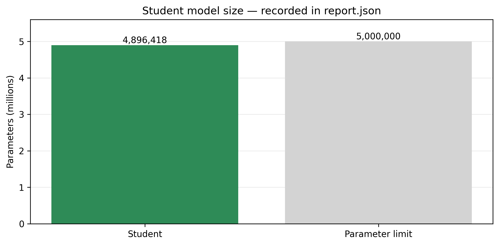
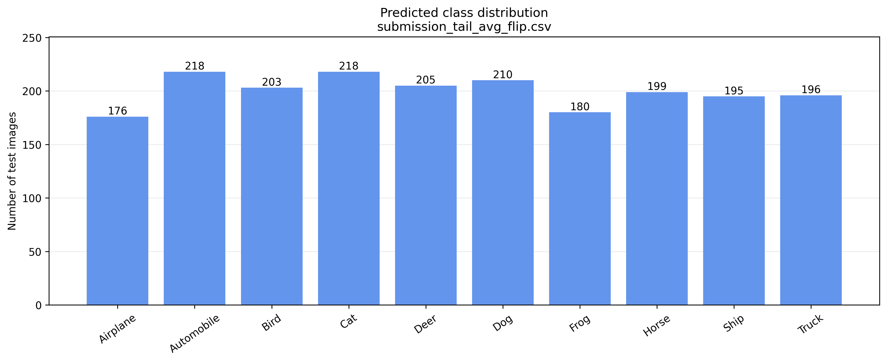

# ResNet Teacher–Student Distillation with Rotation Self-Distillation

This folder contains our teacher–student experiment for the NYU Tandon CIFAR-10 ResNet challenge. Our goal was to train an accurate residual network while keeping the submitted student below 5 million trainable parameters.

We first trained a larger teacher from scratch. We then trained a smaller student using the correct labels, the teacher's predictions, and a rotation-based self-distillation task. The teacher is needed during student training, but it is not part of the final prediction model.

This folder is one experiment within our shared team repository. The project report is a separate document.

## Folder contents

This folder is `resnet_teacher_student_distillation/` in the repository.

| Path | Contents |
| --- | --- |
| `README.md` | This explanation and reproduction steps |
| `notebooks/01_training_results.ipynb` | Executed training notebook, including the full training log |
| `notebooks/02_results_graphs.ipynb` | Executed graph notebook |
| `results/teacher/` | Teacher training history |
| `results/student/` | Student weights, training history, `report.json`, prediction CSVs, and saved test outputs |
| `figures/` | Training curves, prediction-method comparison, parameter count, and predicted class distribution |

The teacher weights and the resume checkpoints are too large for the repository. They are in the GitHub Release described in "Saved artifacts and releases" below.

## Our approach

### 1. Use a shared training and validation split

The competition provides 50,000 labeled training images and 2,000 unlabeled evaluation images. We use 45,000 labeled images for training and keep 5,000 for validation, with 500 validation images per class. Both training stages use the same split.

Validation images are used to check performance and compare prediction choices. They are not included in the training loss. The hidden competition labels are not available to this notebook.

### 2. Train a larger teacher

We train a WRN-28-10 teacher for 300 epochs from random initialization. WRN means Wide Residual Network: it uses residual connections and wider convolutional layers. The teacher learns from the permitted training images and their correct labels.

The teacher has 36,479,194 parameters. It is a training aid; the submitted student is the network we check against the 5 million parameter limit. We do not load externally pretrained weights or use an external training dataset.

### 3. Train a smaller student with teacher guidance

The student is a WRN-34 with width factor 3.25. It is trained for 330 epochs from random initialization. Its loss includes the correct class labels and a knowledge-distillation term that encourages its class probabilities to resemble the frozen teacher's probabilities.

The teacher's probabilities give the student information about several possible classes, rather than only the single correct class. The teacher stays frozen during this stage.

### 4. Add rotation-based self-distillation

During student training, we create four rotated views of each image: 0, 90, 180, and 270 degrees. An extra head predicts a combination of image class and rotation, giving 40 possible outputs: 10 classes times 4 rotations.

We combine information from these rotation predictions into a class distribution. The normal classification head is encouraged to match this detached distribution. This is the self-distillation part: the student learns from information produced within its own network, in addition to learning from the external teacher.

At prediction time, we use the normal classification head. We include the extra rotation head when reporting the student's full parameter count.

### 5. Make training more stable

We use image augmentation, SGD with momentum, weight decay, learning-rate warm-up, and cosine learning-rate decay. Augmentation includes random crops, horizontal flips, TrivialAugmentWide, cutout, and occasional additional image changes. Mixup is disabled in this experiment.

We also keep an exponential moving average (EMA) of model weights. EMA smooths weight updates over training. A separate tail-averaged candidate averages weights saved near the end of student training.

### 6. Compare prediction choices

We evaluate final EMA and tail-averaged student weights using the notebook's flip, multi, and cardinal test-time augmentation (TTA) methods. TTA combines predictions from different views of an image. These are alternative prediction choices for the same student architecture; the teacher is not used for inference.

## Main settings

| Setting | Teacher | Student |
| --- | --- | --- |
| Architecture | WRN-28-10 | WRN-34, width 3.25 |
| Epochs | 300 | 330 |
| Batch size | 128 | 64 original images; four rotated views during training |
| Initial learning rate | 0.1 | 0.04625 |
| Optimizer | SGD, momentum 0.9 | SGD, momentum 0.9 |
| Weight decay | 0.0005 | 0.0005 |
| Learning-rate warm-up | 5 epochs | 5 epochs |
| EMA decay | 0.999 | 0.999 |
| Model seed | 17 | 41 |
| Distillation temperature | Not used | 4 |
| Teacher distillation weight | Not used | 0.88, decreasing to 0.60 over the last 120 epochs |
| Rotation task | Disabled | Enabled |
| Rotation and self-distillation weights | Not used | 0.5 each, with a 10-epoch ramp-up |

## Recorded results

These values come from the saved histories and student `report.json`. They are validation measurements, not hidden Kaggle test scores.

| Measurement | Result |
| --- | --- |
| Best teacher EMA validation accuracy in history | 97.24%, epoch 258 |
| Best student EMA validation accuracy in history | 97.38%, epoch 300 |
| Student trainable parameters, including the rotation head | 4,896,418 |
| Maximum allowed student parameters | 5,000,000 |
| Remaining parameter allowance | 103,582 |

The best value recorded during training does not necessarily describe the final exported checkpoint. The prediction candidates below were evaluated separately after training, using TTA.

| Student weights | TTA method | Validation accuracy |
| --- | --- | --- |
| Tail average | Flip | 97.72% |
| Final EMA | Multi | 97.70% |
| Final EMA | Cardinal | 97.68% |
| Tail average | Cardinal | 97.68% |
| Tail average | Multi | 97.60% |
| Final EMA | Flip | 97.54% |

The highest recorded candidate is `submission_tail_avg_flip.csv`. The training notebook labels `submission_final_ema_multi.csv` as its primary candidate. These filenames identify different predictions, so preserve the exact filename when recording a Kaggle result.

On 5,000 validation images, the difference between 97.72% and 97.70% is only one image. We therefore treat the leading candidates as very close. Repeatedly choosing settings on this validation split can also make its scores optimistic.

No verified Kaggle score for this exact run is included here. A validation score must not be presented as the competition test score. Add the actual public or private Kaggle result, with its exact CSV filename, when it is available.

## How to read the graphs

### Teacher and student training curves





The loss curves fall steadily, showing that both models reduce their training objectives. The student loss includes several terms, so its numerical value should not be compared directly with the teacher's loss.

Validation accuracy rises quickly and then improves more slowly. EMA produces a smoother curve, especially early in training. Training accuracy is measured on harder augmented images, which helps explain why it is lower than clean-image validation accuracy.

The learning-rate curves show a short warm-up followed by a gradual decrease toward zero. The validation curves do not show an obvious sustained decline near the end, although the curves alone cannot prove generalization to the hidden test set.

### Prediction-method comparison



This chart compares validation scores for the different weights and TTA choices. Tail-averaged weights with flip TTA have the highest recorded score, but the leading methods are very close. The horizontal axis is shortened to make these small differences visible.

### Teacher–student comparison



This chart compares their EMA validation curves. Each horizontal position is an epoch within that model's own training, not equal elapsed time. The student has a separate training stage and a different objective. Its slightly higher best accuracy is encouraging, but proving that distillation caused the gain would require a matching student run without distillation.

### Parameter budget



The chart uses the parameter count recorded in `report.json`. It shows that the student, including the auxiliary head, is below the limit. The teacher's parameters are not added to the inference model.

### Predicted class distribution



This chart counts the test images assigned to each class by `submission_tail_avg_flip.csv`, the candidate selected by the graph cell from validation results. It can reveal a strong concentration in one predicted class. It does not measure accuracy or show the true class distribution, because test labels are hidden.

## Reproduce training in Google Colab

1. Open `notebooks/01_training_results.ipynb` in Colab. Its existing outputs can be read without rerunning it.
2. For a new training run, select a GPU runtime. An A100 is useful for speed; runtime availability is controlled by Colab.
3. Obtain the permitted competition dataset as `data-DL.zip`. Upload it when prompted, or place it at `MyDrive/data-DL.zip` before running.
4. Run the training cell and authorize the Google Drive mount.
5. Keep the default two-stage configuration to train the teacher first and the student second. No existing model checkpoint is required for a fresh run.
6. Outputs are written under `/content/drive/MyDrive/Operation90_TwoStage/`. The teacher and student have separate run folders.
7. Preserve both run folders. `last.pth` saves progress each epoch. If a session ends, reconnect, mount the same Drive, provide the dataset again if needed, and rerun with the same settings to resume.

The full workload is 300 teacher epochs followed by 330 student epochs. The student processes four rotated views per original image and also evaluates a frozen teacher during training. Plan for hours of GPU time, rather than a short demonstration. Actual time depends strongly on the assigned GPU, storage, and session interruptions. Histories record `epoch_seconds`; these timings do not include all data preparation and final prediction work.

This version is Colab-specific. It uses `google.colab`, a Drive mount, `/content/` paths, and the fixed dataset filename above. It will need path and input-handling changes to run as an ordinary local Jupyter notebook. Local extraction and cache files are temporary; Drive checkpoints persist. Seeds help repeat the experiment, but exact numerical agreement across hardware and software versions is not guaranteed.

The notebook uses PyTorch, torchvision, NumPy, pandas, Pillow, tqdm, and Colab utilities. The graph notebook also uses Matplotlib. It does not install a pinned environment automatically. Preserve the package versions and GPU information printed by the executed run when documenting the environment.

## Recreate the graphs without training

1. Open `notebooks/02_results_graphs.ipynb` in Colab and select a CPU runtime.
2. Run the first cell. Upload `results/teacher/history.csv` and `results/student/student_submissions.zip` together.
3. Run the second cell. It reads the student's history, report, and prediction CSV directly from the ZIP.
4. Download `all_training_graphs.zip`. Copy its PNG files into this folder's `figures/` directory so the images above display on GitHub.

This process does not run any training epochs and does not require model checkpoints or a GPU. Confusion matrices and per-class accuracy are not included: they require validation predictions and true validation labels.

## Saved artifacts and releases

The smaller results and the student weights are stored in this repository. The larger teacher weights and the resume checkpoints are in the GitHub Release: **[v1.0-weights](https://github.com/NeelGaji/Prometheus/releases/tag/v1.0-weights)**

| File | Location | Purpose |
| --- | --- | --- |
| `student_final_ema.pth` | `results/student/` | Final EMA student weights |
| `student_tail_avg.pth` | `results/student/` | Tail-averaged student weights |
| `history.csv` | `results/teacher/` | Teacher training history |
| `history.csv` | `results/student/` | Student training history |
| `report.json` | `results/student/` | Parameter count and validation results |
| `submission_*.csv` | `results/student/` | Competition predictions |
| `test_logits_*.npy` | `results/student/` | Saved model outputs for the test images |
| `student_submissions.zip` | `results/student/` | Student `history.csv`, `report.json`, and the six prediction CSVs; this is the file to upload to the graph notebook |
| `teacher_final_ema.pth` | Release | Teacher weights needed to train the student separately |
| `teacher_last.pth` | Release | Optional checkpoint for resuming teacher training |
| `student_last.pth` | Release | Optional checkpoint for resuming student training |

The two `last.pth` files were renamed for the release because both have the same original name.

### Train the student separately

Download `teacher_final_ema.pth` from the release and place it in Google Drive. In the training notebook's settings cell, set:

```python
STAGE = 'student'
TEACHER_CHECKPOINT = '/content/drive/MyDrive/teacher_final_ema.pth'
```

Change the path to match the file's actual location. This trains the student with our saved teacher, without repeating teacher training. Keep the same dataset and the same validation split.

### Optional: resume interrupted training

The two `last.pth` files are only needed to resume training. They are not needed to make graphs or predictions from the exported student weights.

1. Download `teacher_last.pth` or `student_last.pth` from the release.
2. Create a new folder in Google Drive, for example `MyDrive/resume_teacher`, and place the file inside it. Rename it back to `last.pth`.
3. In the settings cell, set `STAGE` to `'teacher'` or `'student'` (not `'both'`) and set `RESUME_SOURCE_DIR` to that folder, for example:

```python
STAGE = 'student'
RESUME_SOURCE_DIR = '/content/drive/MyDrive/resume_student'
```

4. Keep the original training settings unchanged. The notebook copies the folder into `Operation90_TwoStage/` and continues from the saved epoch. It stops with an error if the destination run folder already exists, so remove or rename an older folder with the same name first.
5. Resuming the student also requires the teacher's exported weights. Either keep `teacher_final_ema.pth` in the teacher run folder, or set `TEACHER_CHECKPOINT` as described above.

## References and attribution

The methods used here include Wide Residual Networks, knowledge distillation, and self-supervised label augmentation. Background references are:

- Zagoruyko and Komodakis, *Wide Residual Networks* (2016): https://arxiv.org/abs/1605.07146
- Hinton, Vinyals, and Dean, *Distilling the Knowledge in a Neural Network* (2015): https://arxiv.org/abs/1503.02531
- Lee, Hwang, and Shin, *Self-supervised Label Augmentation via Input Transformations* (2020): https://arxiv.org/abs/1910.05872

These references describe the underlying ideas, not evidence of our measured results. 
